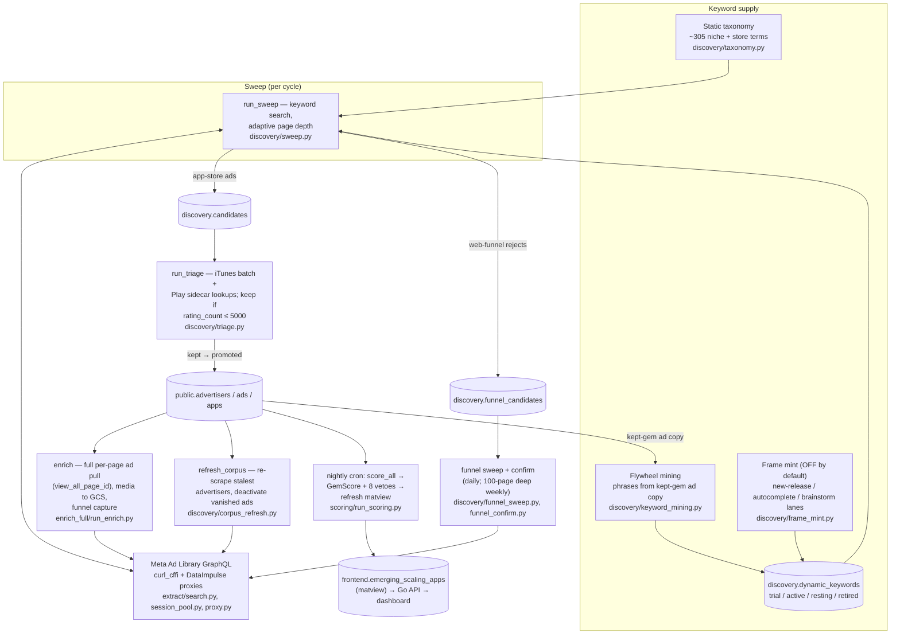
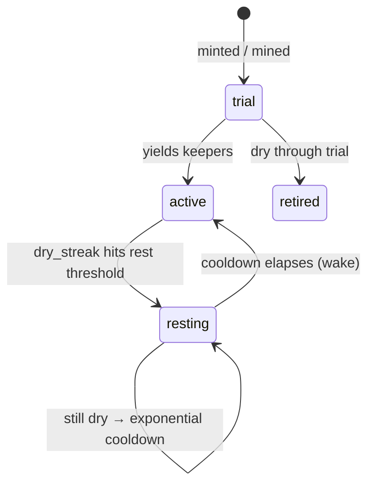

# Scraping pipeline — how it works today

_As of 2026-07-10. Every claim below is from current code (paths cited). Render the diagrams with any Mermaid viewer (VS Code preview, GitHub)._

**One paragraph:** the worker sweeps Meta's Ad Library (internal GraphQL, through residential proxies) with a pool of keywords, writes every advertiser it finds into `discovery.candidates`, triages them against the app stores (keep = small app with real ads), enriches keepers (full ad pull, media, funnel probe), and periodically re-scrapes known advertisers so their ad history stays fresh. A cron re-scores everything nightly into GemScore + vetoes and refreshes the matview the dashboard reads. Keywords themselves are a managed population: mined from what we already like, rested when dry, woken later.

## Big picture

## 1. The worker cycle

One process, one loop: `src/agf/workers/main.py` (`main()` at `main.py:1002`). Runs continuously (`AGF_CONTINUOUS_DISCOVERY=1` default), sleeps `AGF_SWEEP_INTERVAL_SEC` (60s) between cycles. Each cycle `run_once` (`main.py:500-879`) runs these stages in order — most are daily-gated, so a typical cycle only does the ones that are due:

| # | Stage | What it does | Cadence / budget |
|---|-------|--------------|------------------|
| 1 | `run_sweep` | keyword search sweep of the Ad Library | per `discovery_due` gate |
| 2 | `run_triage` | keep/drop new candidates via store lookups | per cycle |
| 3 | `snapshot_advertiser_week` | roll weekly active-ad counts | per cycle |
| 4 | `resolve_pending_app_metadata` | fill iTunes/Play metadata | per cycle |
| 5 | `refresh_apps` | daily store snapshot + reviews for known apps | daily |
| 6 | `pull_keeper_history` | backfill ad history for keepers | half of `AGF_DISCOVERY_ENRICH_BUDGET` (600) |
| 7 | `run_funnel_stage` | funnel sweep + confirm | daily (`funnel_due`) |
| 8 | `refresh_corpus` | re-scrape stalest advertiser listings | daily, own budget `AGF_CORPUS_REFRESH_BUDGET` (3000) |
| 9 | `mint_keywords_from_releases` | frame-mint new keywords | **off by default** (`AGF_RELEASE_MINT=0`) |
| 10 | `run_flywheel_stage` | mine + trial + retire dynamic keywords | `flywheel_due` gate |
| 11 | embeddings | `embed_apps`, `score_all_users`, `embed_candidates` (triage prior) | per cycle |
| 12 | enrich | full enrichment of top advertisers | remaining budget ÷ ~14 Meta requests per gem |
| 13 | repairs | `media_repair`, `funnel_repair`, `run_websub_bridge` | per-cycle caps (`AGF_*_REPAIR_PER_CYCLE`) |

Scoring is **not** in the worker by default — the nightly cron owns it (`AGF_SCORE_AFTER_SWEEP` can opt the worker in).

Safety rails: heartbeat file + in-process watchdog that SIGKILLs on stale heartbeat (`main.py:882-957`); every Meta call that could hang through a stalled proxy tunnel runs under a daemon-thread wall-clock ceiling, `_call_with_ceiling` (`main.py:177-206`, `AGF_PREFETCH_TIMEOUT_SEC=180`).

## 2. Keyword supply and lifecycle

Three sources feed the sweep:

- **Static taxonomy** (`discovery/taxonomy.py`) — ~305 hand-curated `niche_term` + `store_fragment` entries, swept daily, plus 28 `funnel_phrase` entries used only by the funnel sweep.
- **Flywheel mining** (`discovery/keyword_mining.py`) — n-gram phrases mined from the ad copy of gems we already kept (`frontend.emerging_scaling_apps`), trialed as dynamic keywords.
- **Frame mint** (`discovery/frame_mint.py`) — mints search keywords from app-store new releases + store autocomplete (generalized by Gemini) + brainstorm lane. Currently **disabled by default**.

Dynamic keywords live in `discovery.dynamic_keywords` and move through a state machine (`db/dynamic_keywords.py`):

Nothing is permanently dropped anymore — the old terminal "retire on dry streak" was replaced by rest/wake with exponential cooldown (`record_keyword_sweep`, `dynamic_keywords.py:117`).

## 3. Sweep mechanics

`run_sweep` (`discovery/sweep.py:134`) iterates live keywords. Per keyword it pages the Ad Library search with **adaptive depth** — keep paging while all of these hold:

1. Meta says `has_next` and returns a cursor (`sweep.py:219`)
2. fewer than `AGF_SWEEP_PATIENCE_PAGES=3` consecutive pages with nothing new (`sweep.py:221`)
3. under the per-keyword depth cap (`sweep.py:223`)

The Meta call chain: `extract/facade.py` → `extract/search.py` (`search_page`, GraphQL doc + variables) → `curl_cffi` TLS-impersonated session (`extract/tls_client.py`, `session_pool.py`) → DataImpulse residential proxies with round-robin + dead-proxy cooldown (`extract/proxy.py`, `AGF_PROXIES`).

Each result is classified (`classify_candidate`, `sweep.py:44`): app-store ads upsert into `discovery.candidates` (`db/candidates.py:13`, tracks `first_seen_depth`, `times_seen`); web-funnel-shaped rejects fold into `discovery.funnel_candidates` instead of being dropped. One veto applies at sweep time: pages with more than `INCUMBENT_PAGE_LIKES_MAX=10,000` likes are skipped as incumbents (`sweep.py:51`).

## 4. Triage

`run_triage` (`discovery/triage.py:56`) looks each new candidate up in its store — iOS via `lookup_itunes_batch` (chunks of 200), Android via the Node sidecar subprocess `sidecar/gp_lookup.js` (chunks of 50). The keep/drop rule is a single gate: drop if `rating_count > ESTABLISHED_RATINGS_MAX` (5,000) — i.e. keep small apps (`triage.py:31`). An empty iTunes result means genuinely delisted; a sidecar crash means "lookup failed, retry" and never writes a verdict (`triage.py:9-13`). Kept candidates are promoted into `public.advertisers`/`public.apps` (`triage.py:48`). A taste embedding (`triage_prior.py`, `candidate_embed.py`) reorders the enrich budget toward candidates similar to liked gems — advisory only, breadth stays taste-blind.

## 5. Enrich

`enrich_gem` (`enrich_full/run_enrich.py:190`) does the deep pull per advertiser: page-scoped `view_all_page_id` search (`active_status=ALL`) for the full ad listing, prefetched **outside** the DB transaction (`main.py:209-248`), off-store/funnel ads sorted first, top 5 ads captured with media (cap 120) uploaded to GCS, and any web landing probed + screenshot via `funnel_capture.py`. Costs ~14 Meta requests per gem, which is what divides the remaining enrich budget into a per-cycle gem count (`main.py:792`).

## 6. Corpus refresh (maturation)

`refresh_corpus` (`discovery/corpus_refresh.py:29`) re-scrapes the *stalest* known advertisers' full listings (12 history pages each) under its own budget of 3,000 requests/day. This is what lets found advertisers **mature**: new ads accrue, vanished ads flip `is_active=false`, so `winner_age` and growth axes downstream reflect reality instead of freezing at discovery time. (This stage being dead for a month was the July gem-plateau root cause.)

## 7. Funnel pipeline

Daily (`funnel_due`): `run_funnel_sweep` (`discovery/funnel_sweep.py:49`) sweeps the 28 static `funnel_phrase` keywords up to 8 pages, writing `discovery.funnel_candidates`; app-backed funnels bridge back into the app pipeline. Weekly, the same phrases get a **100-page deep sweep** (`AGF_FUNNEL_DEEP_PAGES=100`, every 7 days). Then `run_funnel_confirm` (`funnel_confirm.py:101`) renders each landing page and confirms it as a funnel if it shows payoff evidence, a quiz of ≥2 steps, or pixel + funnel-host fingerprints — verdict stored as `payoff_kind` (install/subscribe/unknown), never used to hide the row.

## 8. Scoring and the feed

Nightly cron (`ops/cron/snapshot.sh`, 02:15) runs `run_scoring` (`scoring/run_scoring.py:168`):

- **GemScore** (`scoring/gemscore.py:3`): `100 · SV^.42 · UR^.12 · FI^.03 · D^.38 · W^.05` — scaling velocity (winner age capped 35d, depth, count growth), user ratings, funnel intensity, demand, web presence.
- **8 vetoes** (`scoring/vetoes.py:86`): persistence (<2 weeks), relaunch, game app, no app, unverified app, incumbent ad volume (>200 active ads), incumbent audience (>10k page likes), established traction (>5,000 ratings).
- Writes `adtech.advertiser_scores`, then `REFRESH MATERIALIZED VIEW CONCURRENTLY frontend.emerging_scaling_apps` — the matview the Go API (`backend/`) serves to the dashboard. A separate hourly cron re-refreshes the matview.

## 9. Data model at a glance

| Schema | Tables | Role |
|--------|--------|------|
| `discovery.*` | `candidates`, `funnel_candidates`, `dynamic_keywords`, `sweep_runs`, `flywheel_runs`, `funnel_sweep_runs`, `corpus_refresh_runs` | pipeline working state |
| `public.*` | `advertisers`, `ads`, `apps`, `funnels` | the corpus (kept entities) |
| `adtech.*` | `advertiser_scores`, `app_metrics`, `app_advertiser_metrics` | scores + metrics |
| `logging.*` | `crawl_log` | DB-as-queue for the enrich scheduler |
| `frontend.*` | `emerging_scaling_apps` (matview), review/ratings tables | what the product reads |

Schema DDL: `db/schema/NNN_*.sql`, applied by `src/agf/db/migrate.py`.

## 10. Where it runs

`ops/docker-compose.yml` on the `agf-worker` GCP VM: `postgres` isn't used in prod (Cloud SQL is), the live services are **`worker`** (`python -m agf.workers.main`, healthcheck every 60s, `init: true` so the watchdog kill actually works), **`cron`** (matview hourly, score+snapshot 02:15, prune 03:30, backup 04:00), plus the Go `api` on GKE. The Google Play "sidecar" is a Node subprocess inside the worker container, not a separate service. Proxies are in-process via `AGF_PROXIES` — no gateway container.

## Knobs cheat-sheet

| Env var | Default | Controls |
|---------|---------|----------|
| `AGF_SWEEP_INTERVAL_SEC` | 60 | pause between worker cycles |
| `AGF_SWEEP_PATIENCE_PAGES` | 3 | dry pages before a keyword's sweep stops |
| `AGF_DISCOVERY_ENRICH_BUDGET` | 600 | Meta requests/cycle split between keeper history + enrich |
| `AGF_CORPUS_REFRESH_BUDGET` | 3000 | daily corpus-refresh request budget |
| `AGF_FUNNEL_MAX_PAGES` / `_DEEP_PAGES` | 8 / 100 | funnel sweep depth, daily vs weekly deep |
| `AGF_PREFETCH_TIMEOUT_SEC` | 180 | wall-clock ceiling per advertiser Meta pull |
| `AGF_RELEASE_MINT` | 0 (off) | frame-mint keyword lane |
| `AGF_PROXIES` | — | DataImpulse residential proxy list |
