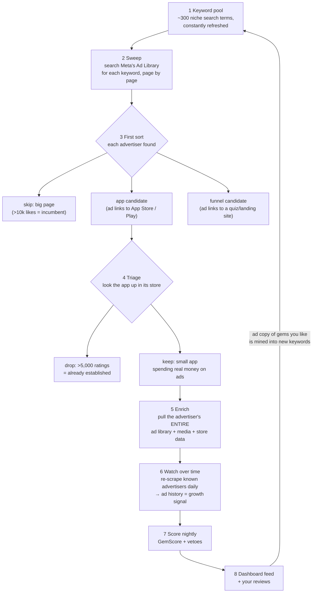

# How the scraping works — the full journey

_As of 2026-07-10. This walks the data end to end: what we ask Meta, what comes back, and what decision happens at each step. Code locations are in the appendix._

## The core problem the whole design answers

Meta's Ad Library has **no "list all ads" door**. You can't ask "show me every app ad running in the US." The only ways in are: search by keyword, or pull one specific page's ads if you already know the page. That single constraint shapes everything below — we discover new advertisers **by searching**, and we deepen what we know about found advertisers **by pulling their page directly**.

## 1. Keywords — what we search with

We maintain a pool of search terms that emerging app ads would contain:

- **~305 hand-curated static terms** — niche phrases ("sleep tracker", "couples app") and store-link fragments — swept every day, taste-blind. This is the breadth backbone.
- **Mined terms (the flywheel)** — we take the ad copy of gems we already kept, extract phrases that repeat across multiple advertisers (repetition = a real shared marketing angle, not one app's slogan), and trial them as new keywords.
- **28 funnel phrases** ("take the quiz", etc.) that feed the separate funnel lane.

Keywords are a managed population, not a fixed list. Each one carries a track record: if it stops producing new advertisers it **rests** (with an exponentially growing cooldown), then wakes and gets retried later. Nothing is thrown away permanently — a keyword that's dry today can be fertile in three months when a new niche appears.

## 2. The sweep — how one search actually happens

For each live keyword, we call the **same internal GraphQL endpoint the Ad Library website itself uses** (the official API is useless for commercial ads — it's effectively political-ads-only). To not get blocked we:

- impersonate a real Chrome browser at the TLS level (curl_cffi), and
- route every request through rotating **residential proxies** (DataImpulse), with dead proxies benched on a cooldown.

Meta answers with a page of ads (**sorted by impressions, biggest spenders first** — important below) plus a cursor for the next page. Per keyword we keep paging **adaptively**: as long as new advertisers keep appearing, go deeper; after **3 consecutive pages with nothing new**, stop. Broad fertile keywords go deep, narrow ones stop at page 1, so the request budget flows to where the yield is.

The impressions-first ordering matters: the top of page 1 is dominated by the Calms and Duolingos. The gems — small brand, real spend — sit **below** them, which is exactly why the pagination is adaptive instead of "first 2 pages only" (an earlier design that cut gems off).

## 3. What comes back, and the first sort

Each ad in a result carries: the **Meta page** running it (name, page ID, **page like count**), the creative (text, images/video), the **link the ad points to**, start date, and whether it's still active. That's enough for a first classification of every advertiser found:

- If the page has **more than 10,000 likes**, we skip it entirely — a big audience means they're past "emerging".
- If the ad links to the **App Store or Google Play**, it becomes an **app candidate**, recorded together with the keyword that found it and how deep in the results it sat.
- If the ad links to a **web landing page** (a real one — not a store redirect, not social, not an ad-tracker bounce), it becomes a **funnel candidate** and goes to the funnel lane (section 9). A web quiz/landing funnel is a product signal of its own.
- Everything else — physical products, services, junk — is discarded.

Seeing the same advertiser again on a later sweep isn't wasted — we bump its "times seen" counter, which is itself weak evidence of sustained spend.

## 4. Triage — "is this app small enough to be interesting?"

A candidate is just "someone running app ads." Triage answers: **is it emerging, or already big?** We look the app up in its store — iOS through Apple's lookup API (batched 200 at a time), Android through a Google Play scraper (batched 50). One gate decides:

> **rating count > 5,000 → drop (established). Otherwise → keep.**

That's deliberately the only gate. Installs, revenue estimates, longevity floors — all tried and removed; rating count proved the cleanest "already made it" signal that works identically on both stores. A kept candidate is promoted into the corpus: it gets an advertiser record, an app record, and enters the tracking loop.

The keep decision is taste-blind, but *the order* in which keepers get enriched isn't: each candidate's store listing is embedded and compared to the profile of gems you've liked, so the enrich budget reaches for likely-likable apps first (75% taste, 25% random exploration).

## 5. Enrich — the deep look at a keeper

Discovery only saw whatever ads happened to surface for one keyword. Enrichment pulls the advertiser's **entire ad library** by page ID — every ad, active and inactive, no keyword involved. Per keeper we:

- pull the full ad listing (~14 Meta requests' worth of budget per gem),
- store every ad with its start date / end date / active status — this becomes the ad-history timeline,
- download creatives (images, video) for the top ads into cloud storage so the dashboard can show the actual ads,
- snapshot the store listing (ratings, reviews, screenshots, description),
- and if any ad points at a web page, render it headlessly, screenshot it, and classify what it is (quiz funnel? subscription checkout?).

Now we're no longer looking at "an ad we found" — we're looking at **a company's whole advertising operation**.

## 6. Watching over time — where the growth signal actually comes from

A single snapshot can't tell a scaling app from a dying one. The signal is in the **ad library's movement**:

- new ads appearing week over week = active testing/scaling,
- the same ad running for weeks = a **proven winner** (nobody pays Meta for a month for an ad that doesn't convert),
- ads vanishing = tests killed, or the whole operation winding down.

So every day, a dedicated budget (3,000 requests) re-scrapes the **stalest** known advertisers' full listings: new ads get added, vanished ads get flipped inactive, weekly active-ad counts get snapshotted. This maturation loop is load-bearing — when it silently died for a month, every newly found advertiser stayed frozen at its discovery snapshot and the gem feed plateaued.

## 7. Scoring — what we're actually looking for

Nightly, every advertiser in the corpus gets a **GemScore** (0–100). In plain words, the two axes that dominate:

- **Scaling velocity (~42% of the weight):** how long their winning ads have been running (capped at 35 days — a month of continuous spend already proves a winner; beyond that just measures age, and rewarding raw age would rank incumbents first), how deep the ad set goes, how fast the ad count is growing, whether they iterate creatives.
- **Demand (~38%):** is the store side confirming it — ratings accumulating, reviews coming in.

plus small weights for user-rating quality, having a funnel, and web presence. Then **vetoes** hard-kill anything that isn't the target profile, whatever its score:

- ads running for **less than 2 weeks** — too early to tell, could be a one-off test
- **more than 200 active ads** — that's a funded growth team, not emerging
- **more than 10,000 page likes** — already has distribution
- **more than 5,000 store ratings** — already made it
- it's a **game** — out of scope
- **no app**, or the store listing can't be resolved — nothing to track
- a **relaunch** of an old app — not genuinely new

What survives is the product's definition of a gem: **a small, verified, non-game app whose ad library shows sustained, growing spend with proven winner ads, backed by real store demand.**

## 8. The feed, and how your reviews feed back in

Scored survivors land in the dashboard (one row per product, iOS+Android merged), ranked by GemScore. Your reviews close two loops:

- **Ranking loop:** likes/dislikes train a preference model that reorders the review queue and steers the enrich-priority embedding from section 4.
- **Discovery loop (the flywheel):** the ad copy of gems you keep is mined for recurring phrases, which become new search keywords — what you like literally changes what we search for next.

## 9. The funnel lane (runs alongside)

Some of the best signals aren't app ads at all — they're **web quiz funnels** (localized quiz → subscription checkout) that often precede or accompany an app. This lane:

- sweeps the 28 funnel phrases daily (8 pages deep) and picks up funnel-shaped rejects from the app sweep,
- once a week runs a **100-page deep sweep** of the same phrases (funnels hide deep in impressions-ranked results),
- then **confirms** each candidate by actually rendering the landing page: counting quiz steps, fingerprinting payment/pixel vendors, classifying the payoff (app install / web subscription / physical — only digital is kept),
- app-backed funnels bridge back into the app pipeline; pure web funnels surface in the feed with a "Web only" badge.

## The whole thing in one sentence

We search Meta's Ad Library with a self-improving pool of niche keywords, keep every small app we catch spending real ad money, pull and then keep re-pulling their entire ad operation to watch it move, and nightly score that movement — sustained winners plus growing spend plus confirming store demand — into a ranked feed of apps that are scaling before they look big anywhere else.

---

## Appendix: where things live

- Worker loop, stage order, budgets — `src/agf/workers/main.py` (`run_once`)
- Keyword taxonomy, lifecycle, mining — `src/agf/discovery/taxonomy.py`, `db/dynamic_keywords.py`, `keyword_mining.py`
- Sweep + adaptive depth — `src/agf/discovery/sweep.py`
- Meta GraphQL client + proxies — `src/agf/extract/search.py`, `session_pool.py`, `proxy.py`, `tls_client.py`
- Triage + store lookups — `src/agf/discovery/triage.py`, `enrich_full/appstore.py`, `enrich_full/sidecar/gp_lookup.js`
- Enrich — `src/agf/enrich_full/run_enrich.py`, `funnel_capture.py`
- Corpus refresh — `src/agf/discovery/corpus_refresh.py`
- Funnel sweep/confirm — `src/agf/discovery/funnel_sweep.py`, `funnel_confirm.py`
- GemScore + vetoes — `src/agf/scoring/gemscore.py`, `vetoes.py`, `run_scoring.py`
- Feed matview — `db/schema/141_emerging_matview_websub.sql` → `frontend.emerging_scaling_apps`
- Runtime — `ops/docker-compose.yml` (worker + cron on the VM), Go API on GKE

Key knobs: `AGF_SWEEP_PATIENCE_PAGES=3` (dry pages before a keyword stops), `AGF_DISCOVERY_ENRICH_BUDGET=600` (per-cycle Meta requests, split keeper-history/enrich), `AGF_CORPUS_REFRESH_BUDGET=3000` (daily re-scrape budget), `AGF_FUNNEL_DEEP_PAGES=100` (weekly deep funnel sweep), `AGF_PREFETCH_TIMEOUT_SEC=180` (per-advertiser hang ceiling), `AGF_PROXIES` (DataImpulse list). Frame-mint (`AGF_RELEASE_MINT`) is currently off by default.
